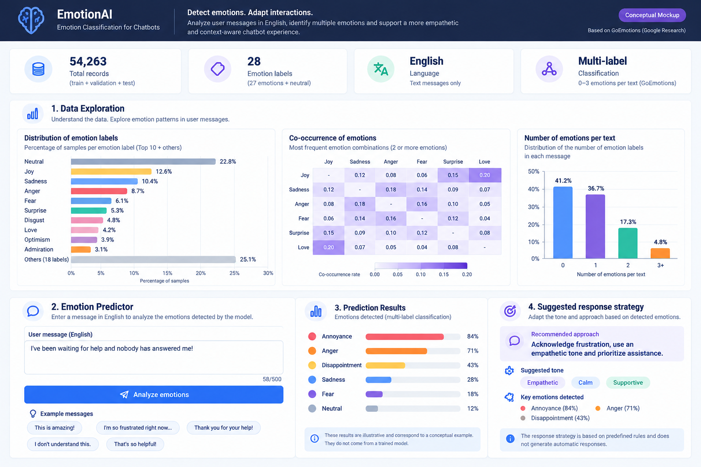

# EmotionAI - Diseño visual del prototipo

## 1. Objetivo

Presentar una propuesta visual de una aplicación para la clasificación multietiqueta de emociones en mensajes escritos en inglés, utilizando el conjunto de datos GoEmotions.

El prototipo permite explorar información descriptiva e identificar emociones mediante un modelo predictivo expuesto a través de una API.

## 2. Componentes del dashboard

### Exploración descriptiva
Visualización de indicadores generales del dataset, distribución de emociones y coexistencia de etiquetas emocionales.

### Clasificación de emociones
Campo de entrada para mensajes en inglés y botón para solicitar una predicción a la API.

### Resultados predictivos
Presentación de las emociones identificadas y sus respectivos puntajes de confianza, considerando que un mensaje puede contener múltiples emociones.

### Estrategia de respuesta
Orientaciones sobre el tono de respuesta a partir de reglas predefinidas asociadas con las emociones detectadas.

Este componente es conceptual y no implica la generación automática de respuestas ni la implementación de un chatbot.

## 3. Consideraciones de diseño

La interfaz se organiza en una sola pantalla con componentes modulares, facilitando su futura implementación mediante Dash.

Los valores y predicciones representados en el mockup son ilustrativos. No corresponden a resultados experimentales ni a estadísticas calculadas sobre GoEmotions.

## 4. Mockup visual

Figura 1. Propuesta visual del dashboard EmotionAI para clasificación multietiqueta de emociones.

## 5. Relación con la pregunta de negocio

El prototipo demuestra cómo un servicio de clasificación de emociones puede proporcionar información estructurada para orientar la adaptación del tono y la estrategia de respuesta de un sistema conversacional.

La evaluación de mejoras en empatía o reducción de fricción con usuarios queda fuera de las funcionalidades demostradas por este mockup.
