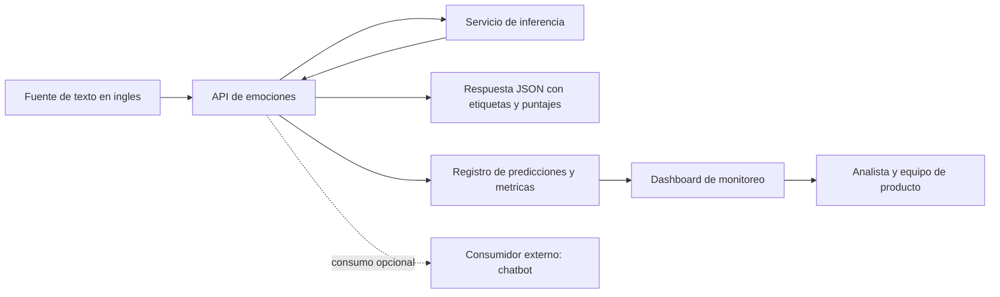

# Mockup del prototipo - API de identificacion de emociones y dashboard

## 1) Objetivo del prototipo

Implementar un prototipo compuesto por:

1. una **API** para inferencia de emociones en texto en ingles;
2. un **dashboard** para explorar metricas del modelo y distribuciones de emociones.

La aplicacion a chatbots se conserva como **caso de uso del problema**, pero el chatbot no forma parte del producto implementado en esta entrega.

## 2) Flujo funcional (alto nivel)



## 3) Vista de componentes del MVP

| Componente | Entrada | Salida | Rol en el MVP |
|---|---|---|---|
| API de emociones | `text` en ingles | emociones + puntajes | Servicio de inferencia |
| Modelo supervisado | features de texto | probabilidades por emocion | Prediccion |
| Dashboard | predicciones + artefactos de evaluacion | metricas y distribuciones | Exploracion y monitoreo |
| Consumidor externo (opcional) | respuesta API | accion de negocio | Integracion futura (fuera de alcance) |

## 4) Contrato inicial de API (propuesto)

### Endpoint

- `POST /v1/emotions/predict`

### Request (ejemplo)

```json
{
  "text": "I feel overwhelmed and I don't know what to do.",
  "language": "en"
}
```

### Response (ejemplo)

```json
{
  "language": "en",
  "predictions": [
    {"label": "nervousness", "score": 0.71},
    {"label": "fear", "score": 0.42},
    {"label": "sadness", "score": 0.31}
  ],
  "top_label": "nervousness",
  "model_version": "baseline_v1",
  "threshold_policy": "global_0.20_with_fallback"
}
```

## 5) Reglas de calibracion (ejemplo conceptual)

| Condicion emocional | Ejemplo de uso por un consumidor externo (p. ej., chatbot) |
|---|---|
| tristeza / nerviosismo / miedo (alta confianza) | tono empatico + instrucciones claras paso a paso |
| enojo / molestia | tono calmado + validacion emocional + enfoque en solucion |
| neutral | tono informativo estandar |
| baja confianza global | respuesta neutra y conservadora |

## 6) Tablero (wireframe textual)

### Panel A - Consulta en vivo

- Caja de texto de entrada.
- Boton "Analizar emocion".
- Tarjeta con top emocion y puntajes.

### Panel B - Tendencia de emociones

- Barras de frecuencia por emocion.
- Filtro por periodo.

### Panel C - Calidad de inferencia

- Confianza promedio por emocion.
- Distribucion de casos de baja confianza.

### Panel D - Evidencia de modelo

- Metricas baseline (F1 micro, F1 macro, precision/recall).
- Version de modelo y fecha de entrenamiento.

## 7) Relacion con requerimientos de la entrega

Este mockup cubre:

- uso de un modelo supervisado empaquetado por API,
- exploracion de inferencias y metricas en dashboard,
- visualizacion de datos y resultados relevantes en tablero.
