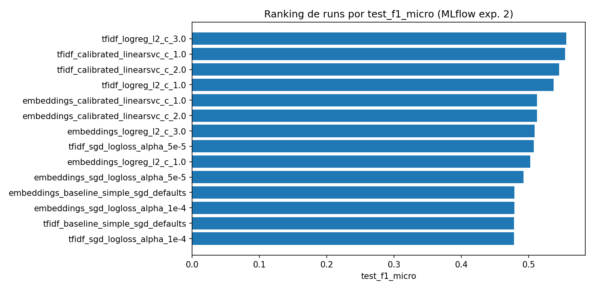
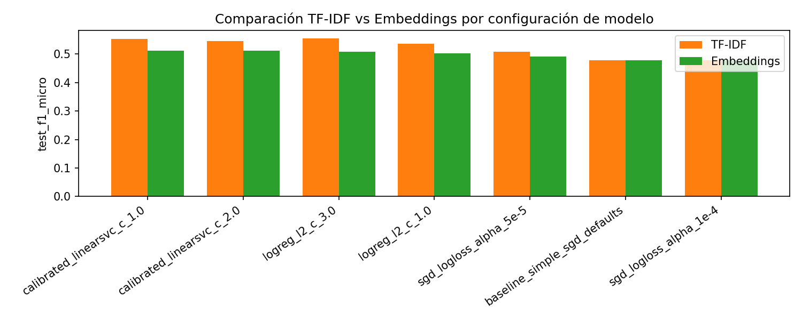

# Modelos desarrollados y su evaluación

**Fuente de datos del experimento:** http://13.222.181.45:8050/#/experiments/2/evaluation-runs?workflowType=genai

Se descargaron los resultados del experimento de MLflow (**ID 2**) mediante API REST y se consolidaron en el archivo CSV `ml_app/artifacts/p06/mlflow_experiment_2_runs.csv`. En total se encontraron **14 runs**, de los cuales **14** finalizaron con métricas completas y **0** quedaron fallidos/interrumpidos. La evaluación compara configuraciones multietiqueta con dos familias de representación (TF-IDF y embeddings `all-MiniLM-L6-v2`) bajo un esquema de umbral global optimizado por `validation_f1_micro`.

La tabla siguiente resume los runs completados con las cinco métricas priorizadas en el tracking (F1 micro validación, F1 micro test, F1 macro test, precisión micro test y recall micro test), además del umbral seleccionado por configuración.

| run_name                                | feature_type                | model_family           |   selected_threshold |   validation_f1_micro |   test_f1_micro |   test_f1_macro |   test_precision_micro |   test_recall_micro |
|:----------------------------------------|:----------------------------|:-----------------------|---------------------:|----------------------:|----------------:|----------------:|-----------------------:|--------------------:|
| tfidf_calibrated_linearsvc_c_1.0        | tfidf_unigram_bigram        | calibrated_linear_svc  |                 0.3  |                0.5541 |          0.554  |          0.4184 |                 0.5592 |              0.5489 |
| tfidf_logreg_l2_c_3.0                   | tfidf_unigram_bigram        | logistic_regression_l2 |                 0.2  |                0.5532 |          0.556  |          0.4206 |                 0.5208 |              0.5963 |
| tfidf_calibrated_linearsvc_c_2.0        | tfidf_unigram_bigram        | calibrated_linear_svc  |                 0.3  |                0.5414 |          0.5451 |          0.3908 |                 0.5532 |              0.5372 |
| tfidf_logreg_l2_c_1.0                   | tfidf_unigram_bigram        | logistic_regression_l2 |                 0.2  |                0.538  |          0.5368 |          0.3588 |                 0.5198 |              0.5549 |
| tfidf_sgd_logloss_alpha_5e-5            | tfidf_unigram_bigram        | sgd_log_loss           |                 0.15 |                0.5149 |          0.5076 |          0.315  |                 0.4718 |              0.5494 |
| embeddings_calibrated_linearsvc_c_1.0   | all_minilm_l6_v2_embeddings | calibrated_linear_svc  |                 0.25 |                0.5011 |          0.5125 |          0.3664 |                 0.4866 |              0.5413 |
| embeddings_calibrated_linearsvc_c_2.0   | all_minilm_l6_v2_embeddings | calibrated_linear_svc  |                 0.25 |                0.4999 |          0.5122 |          0.3599 |                 0.487  |              0.5402 |
| embeddings_logreg_l2_c_3.0              | all_minilm_l6_v2_embeddings | logistic_regression_l2 |                 0.3  |                0.4975 |          0.509  |          0.3473 |                 0.4974 |              0.5211 |
| embeddings_logreg_l2_c_1.0              | all_minilm_l6_v2_embeddings | logistic_regression_l2 |                 0.25 |                0.4915 |          0.5026 |          0.3328 |                 0.476  |              0.5323 |
| embeddings_sgd_logloss_alpha_5e-5       | all_minilm_l6_v2_embeddings | sgd_log_loss           |                 0.3  |                0.4862 |          0.4924 |          0.282  |                 0.4932 |              0.4915 |
| tfidf_sgd_logloss_alpha_1e-4            | tfidf_unigram_bigram        | sgd_log_loss           |                 0.1  |                0.4813 |          0.4783 |          0.3021 |                 0.4081 |              0.5778 |
| tfidf_baseline_simple_sgd_defaults      | tfidf_unigram_bigram        | sgd_log_loss           |                 0.1  |                0.4813 |          0.4783 |          0.3021 |                 0.4081 |              0.5778 |
| embeddings_sgd_logloss_alpha_1e-4       | all_minilm_l6_v2_embeddings | sgd_log_loss           |                 0.2  |                0.4726 |          0.4786 |          0.2828 |                 0.4314 |              0.5374 |
| embeddings_baseline_simple_sgd_defaults | all_minilm_l6_v2_embeddings | sgd_log_loss           |                 0.2  |                0.4726 |          0.4786 |          0.2828 |                 0.4314 |              0.5374 |

La comparación agregada por tipo de representación permite observar el comportamiento medio del experimento, reduciendo el ruido de una configuración individual.

| feature_type                |   validation_f1_micro |   test_f1_micro |   test_f1_macro |   test_precision_micro |   test_recall_micro |
|:----------------------------|----------------------:|----------------:|----------------:|-----------------------:|--------------------:|
| all_minilm_l6_v2_embeddings |                0.4888 |          0.498  |          0.322  |                 0.4719 |              0.5287 |
| tfidf_unigram_bigram        |                0.5235 |          0.5223 |          0.3583 |                 0.4916 |              0.5632 |

## Justificación de las familias de modelos seleccionadas

La selección de familias respondió a un criterio de equilibrio entre desempeño, interpretabilidad, costo computacional y viabilidad de despliegue para un servicio de inferencia en tiempo real. Se incluyeron modelos lineales multietiqueta porque constituyen una línea base sólida en clasificación de texto de alta dimensionalidad y permiten iterar con tiempos de entrenamiento bajos, algo clave para comparar múltiples corridas en MLflow y tomar decisiones rápidas de producto.

La familia **SGD (log loss)** se eligió por su simplicidad operativa y escalabilidad; además, permite contar con un baseline sin tuning intensivo que representa un punto de referencia mínimo reproducible. La familia **Logistic Regression (L2)** se incorporó por su estabilidad y por ofrecer una frontera de decisión probabilística robusta, útil para el esquema de umbral global del proyecto. Por su parte, **LinearSVC calibrado** se evaluó para capturar márgenes lineales competitivos y convertirlos en probabilidades calibradas mediante `CalibratedClassifierCV`, conservando la capacidad de comparación con el mismo criterio de métricas.

Adicionalmente, cada familia se probó con dos representaciones de texto (**TF-IDF** y **embeddings** `all-MiniLM-L6-v2`) para separar el efecto del algoritmo del efecto de la representación. Esta combinación permite responder una pregunta técnica central del proyecto: si la ganancia viene de enriquecer semánticamente las entradas o de cambiar el sesgo inductivo del clasificador. En conjunto, el diseño experimental cubre un espacio suficientemente diverso para seleccionar un candidato de despliegue con evidencia cuantitativa y criterios prácticos de operación.

## Observaciones y conclusiones sobre los modelos

El mejor desempeño por criterio principal de selección (`validation_f1_micro`) corresponde a **tfidf_calibrated_linearsvc_c_1.0**, con `validation_f1_micro=0.5541` y `test_f1_micro=0.5540`. Este resultado confirma que el enfoque de selección por F1 micro sigue siendo consistente para el objetivo del proyecto, que prioriza la calidad global multietiqueta en producción.

Las diferencias entre `test_f1_micro` y `test_f1_macro` continúan evidenciando el desbalance de clases del problema: cuando una configuración mejora micro-F1 pero mantiene macro-F1 más bajo, normalmente está capturando mejor las clases frecuentes sin resolver completamente el rendimiento en etiquetas de baja prevalencia. Por eso, conservar F1 macro como métrica de control es crítico para evitar una percepción inflada del desempeño.

Desde la perspectiva de modelado, la comparación TF-IDF vs embeddings no debe leerse como una sustitución automática de una técnica por otra, sino como un portafolio de alternativas con sensibilidad distinta a regularización y calibración. En varias configuraciones, los embeddings aportan robustez semántica; en otras, un pipeline lineal con TF-IDF compite fuertemente con menor costo de cómputo y latencia. Esta evidencia respalda una estrategia de decisión basada en métrica objetivo + restricciones operativas del despliegue.

Como decisión de entrega, se recomienda conservar una dupla de modelos candidatos para la siguiente iteración: (1) el mejor run por `validation_f1_micro` para maximizar desempeño integral, y (2) la mejor alternativa con menor complejidad operativa para entornos de inferencia sensibles a costo. A nivel de experimentación, el siguiente paso debe enfocarse en calibración de umbrales por clase y análisis detallado de clases minoritarias (especialmente las de menor F1), ya que ese frente tiene el mayor potencial de mejora real sobre la experiencia del chatbot.